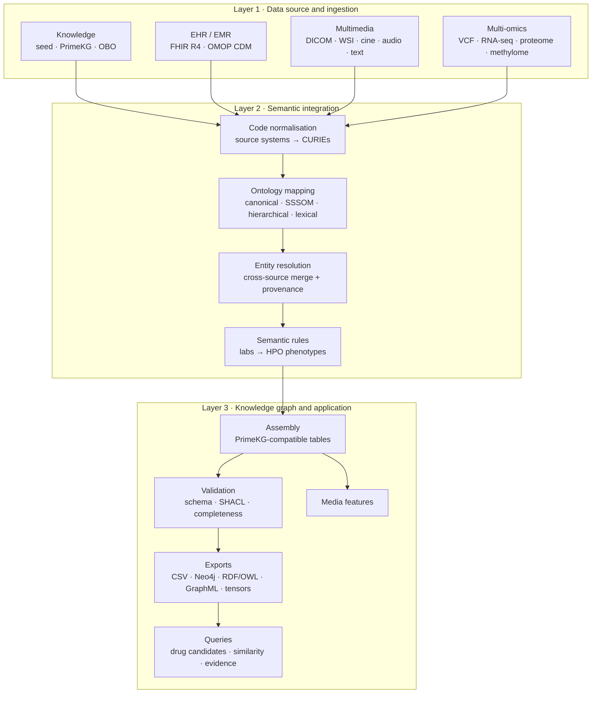

# TriSemKG

**A three-layer semantic framework for multi-modal biomedical knowledge graph construction.**
Reference implementation for the article *"Three-Layer Semantic Framework for Biomedical Knowledge Graph Construction: Architecture, Ontology Mapping, and Reference Implementation."*

TriSemKG builds a precision-medicine knowledge graph that joins four families of data in one graph:

| Facet | Sources | Standards |
| --- | --- | --- |
| Knowledge | Curated seed, [PrimeKG](https://github.com/mims-harvard/PrimeKG) backbone, OBO ontologies | MONDO, HPO, GO, UBERON, NCBI Gene, DrugBank |
| Clinical (EHR/EMR) | HL7 FHIR R4 bundles, OMOP CDM v5 extracts | ICD-10-CM, SNOMED CT, LOINC, RxNorm |
| **Multimedia** | DICOM images, whole-slide images and tiles, ultrasound cine, audio dictations, clinical documents | DICOM, MIME types, SHA-256 content addressing |
| Multi-omics | VCF, RNA-seq, proteomics, DNA methylation | GRCh38, Ensembl, UniProt, HGNC |

Unlike PrimeKG, which integrates 20 reference resources at the knowledge level, TriSemKG adds **patient-level** EHR data, **multimedia objects as first-class nodes** with content features, and **multi-omics measurements**, while keeping PrimeKG's relation names and its `kg.csv` layout so that PrimeKG tools (for example TxGNN) can read the output unchanged.

## The three layers



| Layer | Package | Responsibility | Output |
| --- | --- | --- | --- |
| 1 Data source and ingestion | `trisemkg.layer1_sources` | One adapter per source format; records the codes each source carries without interpreting them | `SourceBatch` of raw entities and relations |
| 2 Semantic integration | `trisemkg.layer2_semantic` | Normalises code systems, maps every entity to one canonical ontology identifier, merges duplicates across sources, derives phenotypes by rule, logs every decision in SSSOM | Canonical nodes and edges, `mappings_applied.sssom.tsv` |
| 3 Knowledge graph and application | `trisemkg.layer3_knowledge` | Assembles, validates (schema and SHACL), extracts media features, exports, answers queries | `kg.csv`, Neo4j import, RDF, statistics |

The schema in [`schema/trisemkg_schema.yaml`](schema/trisemkg_schema.yaml) drives all three layers: 18 node types and 51 relations (PrimeKG's relation types plus 21 new clinical, multimedia, omics and knowledge relations) and the canonical namespace of each type. `trisemkg owl` generates the OWL 2 core ontology [`schema/trisemkg_core.owl.ttl`](schema/trisemkg_core.owl.ttl) from it, aligned to the Biolink Model.

## Quick start

```bash
git clone https://github.com/<your-org>/TriSemKG.git && cd TriSemKG
pip install -e ".[all,dev]"

trisemkg synth --patients 200     # synthetic EHR + multimedia + omics cohort in data/raw/
trisemkg build                    # Layers 1-3; writes output/
pytest                            # 26 tests
```

Or with Docker: `docker build -t trisemkg . && docker run --rm -v $PWD/output:/app/output trisemkg`.

A build of the default synthetic cohort (200 patients, seed 7) takes about 10 seconds and produces:

| Measure | Value |
| --- | ---: |
| Nodes / edges | 1,768 / 5,830 |
| Cross-facet edges | 3,227 |
| Multimedia objects (DICOM, WSI, tiles, cine, audio, reports) | 893 |
| Patients with EHR + multimedia + omics | 61 |
| Patients resolved across FHIR and OMOP | 200 of 200 |
| Disease codes mapped to MONDO | 9 of 10 (one deliberately unmapped) |
| Validation (schema + SHACL) | passed |

Every number is regenerated in `output/stats.md` on each build, including the mapping-coverage table by entity type.

## Outputs

```
output/
├── kg/kg.csv                 PrimeKG layout (relation, display_relation, x_index, x_id, x_type, x_name, x_source, y_…)
├── kg/nodes.csv, edges.csv   full node and edge tables with facet, confidence, provenance, attributes
├── mapping/                  mappings_applied.sssom.tsv (audit trail), rejected_edges.tsv
├── neo4j/                    bulk-import CSVs + import.sh
├── rdf/                      trisemkg.ttl / .nt with reified provenance (prov:wasDerivedFrom, confidence)
├── graphml/                  for Cytoscape, Gephi, NetworkX
├── features/                 per-family content features of multimedia objects
├── validation_report.json    schema, completeness and SHACL results
└── stats.md, stats.json      counts, modality coverage, mapping coverage
```

## Precision-medicine queries

```bash
trisemkg query drugs   MRN00004          # drugs whose predictive biomarker is altered in the patient
trisemkg query similar MRN00004 -k 5     # Jaccard similarity over diagnoses, phenotypes, drugs, altered genes
trisemkg query media   MONDO:0007254     # multimedia evidence for breast cancer
trisemkg query summary MRN00004          # everything linked to a patient
```

Example: for a synthetic patient with a pathogenic *BRCA2* variant, the drug query traverses patient → biosample → variant → gene ← biomarker ← drug → indication → diagnosis and returns olaparib with the variant and its allele fraction as evidence. Cypher and SPARQL equivalents are in [`examples/`](examples/).

## Ontology mapping

Layer 2 resolves each entity through an ordered strategy and records which step succeeded:

| Step | Applies to | Example | Confidence |
| --- | --- | --- | ---: |
| Local identity | patients, encounters, studies, media, samples, variants | MRN00004 → `TRISEM:patient-MRN00004` | 1.0 |
| Canonical identifier | code already in the target namespace | `LOINC:4548-4` | 1.0 |
| Curated / cross-reference mapping | SSSOM sets in `mappings/`, OBO `xref`s | `SNOMEDCT:254837009` → `MONDO:0007254` | from the mapping set |
| Hierarchical fallback | ICD-10-CM codes, truncated until mapped | `ICD10CM:C50.911` → `C50.9` → `MONDO:0007254` (broadMatch) | 0.85 × parent |
| Lexical | labels and synonyms of the canonical ontology | gene symbol `BRCA1` → `NCBIGene:672` | 0.75 |
| Unmapped | nothing matched | `ICD10CM:Z80.3` kept and flagged | 0.5 |

Details and the rule-based enrichment (for example HbA1c ≥ 6.5 % → `HP:0003074` Hyperglycemia) are in [`docs/ontology_mapping.md`](docs/ontology_mapping.md).

## Using real data

1. **Knowledge backbone.** `trisemkg download primekg` (and `mondo`, `hpo`, `go`, `uberon`, `mondo_sssom`), then set `enabled: true` on the matching entries in [`configs/pipeline.yaml`](configs/pipeline.yaml) and add `data/external/mondo.sssom.tsv` under `semantic.extra_mappings`.
2. **EHR/EMR.** Point the `fhir` adapter at a directory of Bundle or NDJSON exports (Bulk FHIR works), and the `omop` adapter at CSV exports of PERSON, VISIT_OCCURRENCE, CONDITION_OCCURRENCE, DRUG_EXPOSURE, MEASUREMENT, PROCEDURE_OCCURRENCE and CONCEPT.
3. **Multimedia.** Point `dicom` at a DICOM folder (headers only are read) and list other objects in a manifest CSV (`media_id, patient_mrn, path, modality, mime_type, study_uid, body_site, finding_code, derived_from`).
4. **Omics.** Provide a sample sheet linking samples to MRNs, a multi-sample VCF with `GENE=` in INFO (or ANN), and feature-by-sample matrices.

See [`docs/data_sources.md`](docs/data_sources.md) for formats, licences and de-identification requirements.

## Repository layout

```
schema/            trisemkg_schema.yaml · trisemkg_core.owl.ttl · shapes.ttl (SHACL)
mappings/          curated SSSOM mapping sets (disease, drug, gene, anatomy)
configs/           pipeline.yaml · phenotype_rules.yaml
data/seed/         curated starter knowledge (nodes.tsv, edges.tsv)
src/trisemkg/
  layer1_sources/  fhir · omop · dicom · media_manifest · vcf · expression · proteomics · methylation ·
                   sample_sheet · seed_knowledge · obo · primekg · synthetic · download
  layer2_semantic/ schema · curie · sssom · mapper · rules · integrator · owl
  layer3_knowledge/graph · validate · features · exporters · query · stats
  pipeline.py · cli.py
tests/             unit and end-to-end tests
docs/              architecture, ontology mapping, data sources, KG format
examples/          Cypher and SPARQL queries, Python quick start
```

## Extending

Add a source by subclassing `SourceAdapter` and registering it; Layer 2 maps whatever codes it emits:

```python
from trisemkg.layer1_sources import SourceAdapter, register
from trisemkg.model import Code

@register("my_registry")
class MyRegistry(SourceAdapter):
    def read(self):
        b = self.batch(self.path.name)
        p = b.entity("p1", "patient", [Code("TRISEM-MRN", "MRN123")])
        d = b.entity("d1", "disease", [Code("http://snomed.info/sct", "254837009")])
        b.relate("patient_disease", p, d)
        yield b
```

New node types or relations go in the schema YAML; new mappings go in `mappings/*.sssom.tsv`; deep media encoders register in `layer3_knowledge.features.EXTRACTORS`.

## Data and identifiers

* All bundled patient data are **synthetic** (`trisemkg synth`). Variant positions lie inside GRCh38 gene spans but are random and carry no clinical meaning.
* The curated seed and mapping sets cover the demonstration cohort only. Check identifiers against current releases of MONDO, HPO, NCBI Gene, DrugBank, RxNorm, LOINC and SNOMED CT before reporting results, and replace the seed with the full PrimeKG backbone for research use.
* SNOMED CT, DrugBank and some LOINC content need their own licences. Real EHR data must be de-identified and used under an approved protocol.

## Citation

If you use TriSemKG, please cite the article (see [`CITATION.cff`](CITATION.cff)) and PrimeKG:

> Chandak P., Huang K., Zitnik M. Building a knowledge graph to enable precision medicine. *Scientific Data* 10, 67 (2023).

## License

MIT for the code. Mapping sets and seed data are CC0. Third-party sources keep their own licences.
